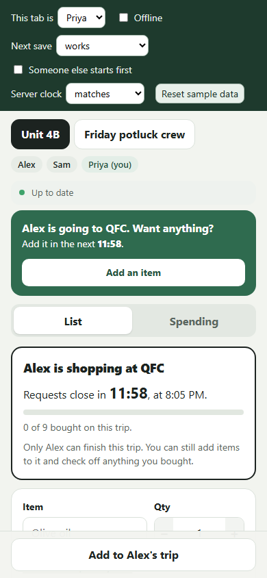
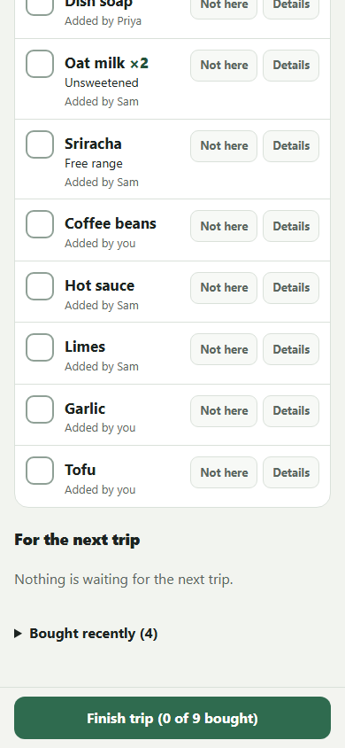

# Shared list, trips, groups, and spending (frontend)

## What this adds

- **List:** add with only a name (quantity 1); quantity, note, store, and date shown on each item; large Bought checkbox; Details panel for edits.
- **Trips:** one action, "I'm going to [store]. Want anything in the next [10] minutes?", reusing the last destination, with an optional 5/10/15-minute window. Starting claims all unbought items. Requests after the claim are marked for the shopper. Finish needs no prices and keeps unchecked items for the next trip.
- **Punt:** if the store doesn't have an item, the shopper taps "Not here" to move it to the next trip. Roommates see why, the shopper can put it back during the trip, and the next trip shows "Not found at QFC last time" until it's bought.
- **Run banner:** other members see "Alex is going to QFC. Want anything?" through snapshot polling, with a countdown from the server's timestamps.
- **Concurrency:** an existing shopper is never replaced; a losing simultaneous start shows the real owner. Item edits use a version number, and conflicts show both versions.
- **Sync status:** up to date, stale, offline, and saves in flight. Failed writes keep input; retries reuse the idempotency key.
- **Groups:** switch between two seeded groups with members shown; no list, trip, or balance data carries over between groups.
- **Spending:** purchases with payer, run, and split/pooled mode; one-total receipts with optional personal items (unknown amounts save as Needs review, not debt); server allocations and balances only; member-provided HTTPS Venmo/PayPal links with copy buttons and an explicit "I've paid" step.

## Screenshots

| Phone, roommate sees the run banner | Phone, shopper with docked Finish |
|---|---|
|  |  |

More in `docs/screenshots/`: shopper view, banner, lost start race, offline with input kept, edit conflict.

## Checks

Run with `python tests/browser_checks.py` against the sample-data build: two tabs acting as two roommates, plus a phone-sized tab. **44 of 44 passed, no console errors.**

**Adding items and keyboard**
- [x] Add with only a name using the Enter key; quantity defaults to 1
- [x] Focus returns to the item field after adding
- [x] Empty name is rejected with a message
- [x] Banner's "Add an item" moves focus to the item field

**Trips**
- [x] Trip destination reuses the last store
- [x] Starting a trip claims all unbought items
- [x] Second browser gets the banner by polling; countdowns match
- [x] Countdown follows server time when the server clock is 2 minutes ahead of the device
- [x] Add before the cutoff joins the trip; the shopper sees it marked new
- [x] Add after the cutoff stays for the next trip and is labeled
- [x] Only the shopper can finish; finish needs no prices and keeps unchecked items
- [x] Bought items move to "Bought recently"
- [x] Losing a simultaneous start shows the real owner; the owner's trip is not replaced

**Punt**
- [x] Punt moves the item off the trip to the next trip, labeled with the store
- [x] Roommate sees the punted label by polling; only the shopper gets punt buttons
- [x] Put back returns the item to the trip without the label
- [x] Finish confirmation and notice mention the punted item
- [x] Next trip claims the punted item, labeled "Not found at QFC last time"
- [x] Buying a punted item clears the label

**Failures and conflicts**
- [x] Offline state is shown; a failed add keeps what was typed
- [x] Retrying after reconnecting saves once
- [x] A save whose reply was lost is not duplicated on retry
- [x] Edit conflict shows the other version, keeps my edit, and "Save mine" works

**Groups and spending**
- [x] Switching groups shows the other group's members and list, with nothing from the old group
- [x] Spending switches with the group and back, with no old balances

**Phone (390 × 844)**
- [x] No sideways scrolling
- [x] Trip action docked at the bottom of the screen
- [x] Bought checkbox is 32 × 32 px
- [x] Docked Finish opens the confirmation

## Still to do before merging

- [ ] Confirm the snapshot shape in the README matches what was agreed with Ibrahiim.
- [ ] Connect the real backend (`npm run dev:api`) and repeat the two-browser checks: banner, add during and after the window, finish, simultaneous start.
- [ ] Spot-check on a real phone (iOS Safari and Android Chrome), including the date picker and the on-screen keyboard over the dock.
